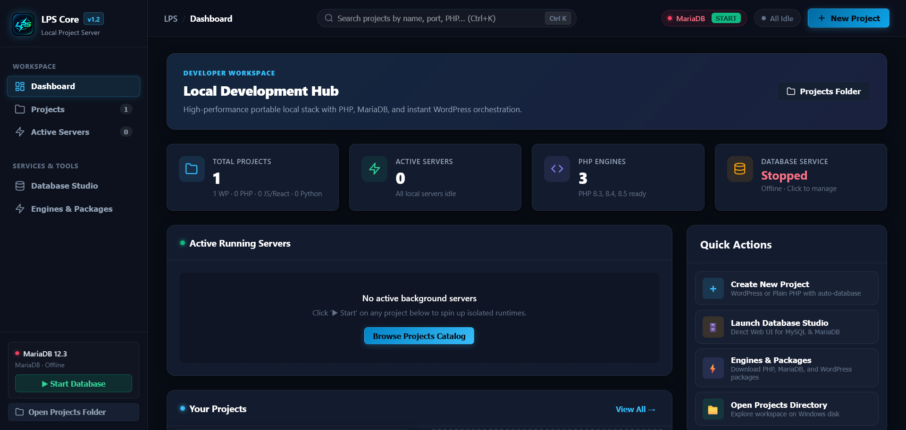
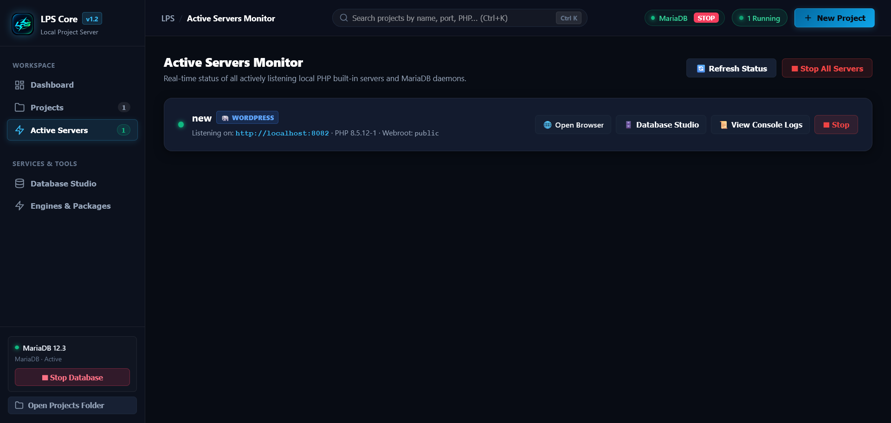
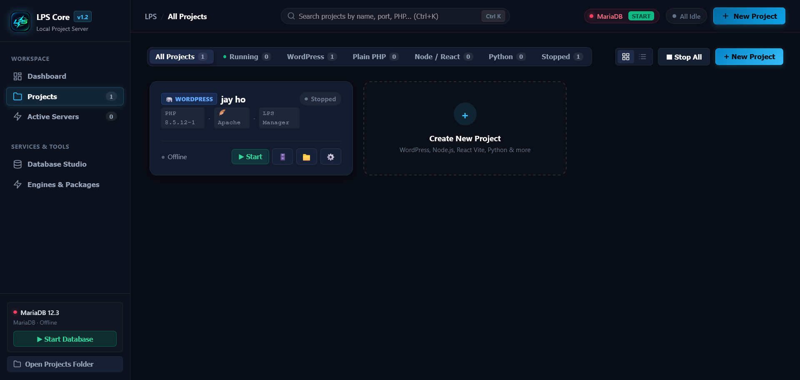
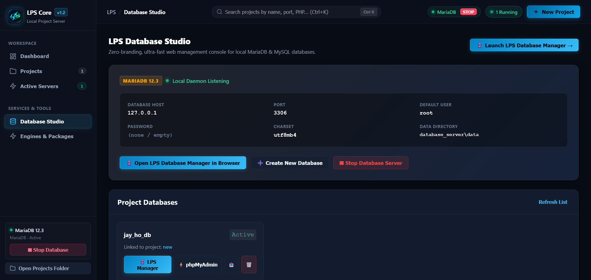
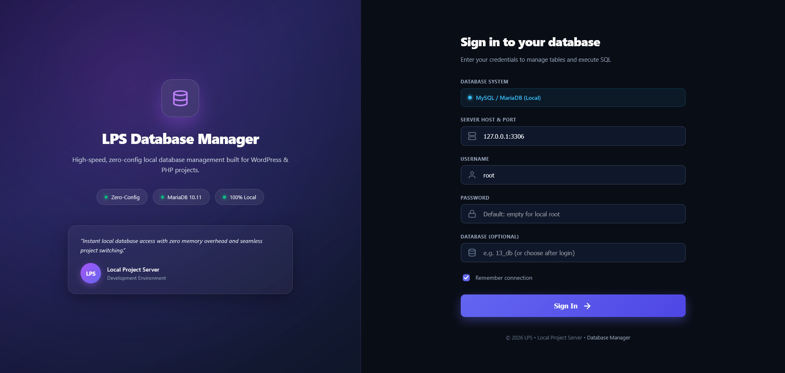
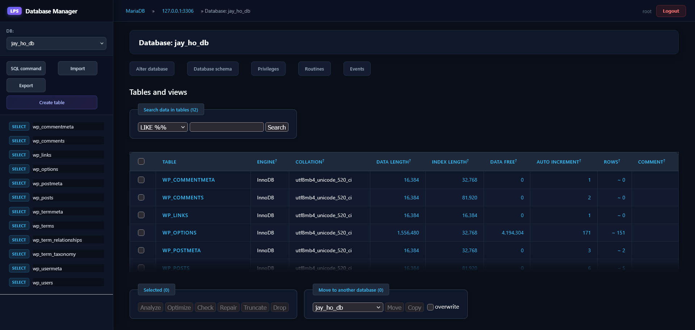

# ⚡ LPS Core — Local Project Server

<p align="center">
  
</p>

<p align="center">
  <a href="#license"></a>
  <a href="#platform"></a>
  <a href="#runtime-testing--status-matrix"></a>
  <a href="#architecture"></a>
  <a href="#database"></a>
  <a href="#privacy"></a>
</p>

<p align="center">
  <strong>The modern, ultra-fast, zero-install local web engineering platform for Windows.</strong><br>
  A lightweight, project-centric alternative to heavy monoliths like XAMPP, Laragon, WampServer, and Docker.
</p>

---

## 🌟 Why LPS Core?

For years, local PHP and WordPress development on Windows has relied on tools designed over a decade ago. Traditional stacks force all your websites into a single shared `htdocs` or `www` directory, lock your entire machine to a single PHP version, and suffer from constant port `80` collisions with Skype, IIS, and Windows services.

**LPS Core redesigns local web engineering from the ground up:**

* 🚀 **Independent Port Architecture:** Every project runs on its own dedicated HTTP port (`8081`, `8082`, `8083`...). Run 5 or 10 different client sites concurrently without conflicts!
* 🔀 **Multi-PHP Version Isolation:** Assign PHP 8.3 to one client app and PHP 8.4 or 8.5 to your latest project. Switch versions with 1 click.
* ⚡ **WordPress First-Class Citizen:** Scaffolds full WordPress sites with auto-generated `wp-config.php`, security salts, database provisioning, and dedicated **WP Admin ↗** and **Site ↗** action buttons.
* 🗄️ **Central High-Efficiency MariaDB 12.3:** A single shared database daemon on port `3306` powers all your projects while keeping database tables completely isolated.
* 🛠️ **Integrated LPS Database Manager:** Built-in, passwordless, high-speed database management console built specifically for local WordPress and PHP workflows.
* 💼 **100% Zero-Dependency Portability:** No installers, no Windows services, and no registry changes. Run it from any folder, an external SSD, or a USB drive.

---

## 📸 Visual Showcase & Screenshots

### 1. Developer Workspace & Active Servers
<p align="center">
  
</p>
<p align="center"><em>Real-time status of all actively listening local PHP built-in servers and MariaDB daemons.</em></p>

---

### 2. Multi-Project Catalog & Port Management
<p align="center">
  
</p>
<p align="center"><em>Manage multiple WordPress and PHP sites with independent ports and 1-click execution.</em></p>

---

### 3. LPS Database Studio & LPS Database Manager
<p align="center">
  
</p>

<p align="center">
  
</p>

<p align="center">
  
</p>
<p align="center"><em>Instant 1-click zero-config database inspection, SQL runner, and table editor.</em></p>

---

## 📊 Comparison: LPS vs Traditional Local Servers

| Feature | XAMPP | WampServer | Laragon | ⚡ LPS Core (Local Project Server) |
| :--- | :--- | :--- | :--- | :--- |
| **Port Management** | Single Port 80 (Frequent Collisions) | Single Port 80 | Virtual Hosts / DNS Hacks | **Dedicated Port Per Project (`8081`, `8082`...)** |
| **Concurrent Projects**| Cluttered in single webroot | Shared webroot | Directory-based | **Run Multiple Sites Concurrently** |
| **PHP Switching** | Global restart required | Global switch | Global switch | **Per-Project Isolated PHP Versions** |
| **WordPress Setup** | Manual DB + config creation | Manual setup | Wizard-based | **Automated Scaffolding + Dynamic Port Adapters** |
| **Database Manager** | phpMyAdmin | phpMyAdmin | HeidiSQL | **Integrated LPS Database Manager** |
| **Installation** | Heavy Windows Installer | Heavy Installer | Windows Installer | **Zero-Install (Extract & Run `lps.exe`)** |
| **Telemetry & Privacy**| Varies | Clean | Clean | **100% Local / Zero Telemetry** |

---

## 🧪 Runtime Testing & Status Matrix

To provide complete transparency to developers, here is the current testing status of LPS features:

| Runtime / Feature | Testing Status | Notes |
| :--- | :--- | :--- |
| **PHP (8.1, 8.2, 8.3, 8.4, 8.5)** | 🟢 **100% Tested & Verified** | Built-in web server and Apache FCGI/CGI execution verified. Multi-PHP concurrent sites confirmed. |
| **WordPress Development** | 🟢 **100% Tested & Verified** | Dynamic host/port detection, `wp-config.php` generation, MariaDB auto-creation, and WP Admin routing fully tested. |
| **MariaDB 12.3 & LPS Database Manager** | 🟢 **100% Tested & Verified** | Automated database cluster initialization (`mariadb-install-db.exe`) and 1-click passwordless login verified. |
| **Apache HTTP Server** | 🟢 **100% Tested & Verified** | Custom `.htaccess`, `mod_rewrite` permalinks, and CGI handlers fully operational. |
| **Node.js & Python Engines** | 🟡 **Functional / Beta Preview** | Runtime executors and environment loaders implemented in engine; undergoing broader real-world community testing. |
| **Modern Framework Templates** | 🟡 **Functional / Beta Preview** | Next.js, React + Vite, Express, and Flask templates available in the project creation wizard; community feedback welcome. |

---

## ⚡ Quick Start (In 30 Seconds)

1. **Download & Extract:** Extract the `LPS` folder anywhere on your system (e.g. `C:\LPS` or `D:\LPS`).
2. **Launch:** Double-click **`lps.exe`**.
3. **Open Dashboard:** LPS starts instantly and opens:
   ```
   http://localhost:9999
   ```
4. **Set Up Runtimes:**
   * **Recommended (Manual):** Download clean, official builds of PHP, Apache, and MariaDB directly from vendor websites and place them into `php_server/`, `web_server/`, and `database_server/` (see [`USER_MANUAL.md`](USER_MANUAL.md) for direct links).
   * **Convenience Mode:** Or use the in-app 1-click downloader under **"Engines & Packages"**.
5. **Create & Run:** Click **`+ New Project`**, choose your project type (WordPress or PHP), select your port, and click **`▶ Start`**!

---

## 📁 Directory Structure

Everything stays self-contained inside your `LPS` directory:

```text
LPS/
├── lps.exe                  # Main LPS Executable & Dashboard Server
├── USER_MANUAL.md           # In-depth setup & runtime placement manual
├── LICENSE.md               # License agreement
├── PRIVACY_POLICY.md        # 100% Zero-telemetry policy
├── README.md                # Project documentation
│
├── projects/                # Your project workspaces live here!
├── php_server/              # Installed PHP binaries (e.g., 8.3, 8.4, 8.5)
├── database_server/         # MariaDB binaries & auto-initialized database data
├── web_server/              # Apache HTTP Server binaries
├── tools/                   # Integrated LPS Database Manager
├── downloaded/              # Cached WordPress and engine packages
└── config/                  # LPS project registry & configuration
```

---

## 📖 Comprehensive Documentation

For complete, detailed instructions on manual runtime placement, Apache `.htaccess` configuration, WordPress dynamic URL handling, and troubleshooting:

👉 Read the [**USER_MANUAL.md**](USER_MANUAL.md).

---

## 🤝 Community & Feedback

LPS is built for developers who demand speed, control, and zero bloat. If you encounter any bugs, have feature requests, or want to contribute:
* Submit issues on our GitHub Issues page.
* Pull requests and community runtime testing reports are warmly welcomed!

---

<p align="center">
  Crafted with ❤️ for the modern web developer community.
</p>
